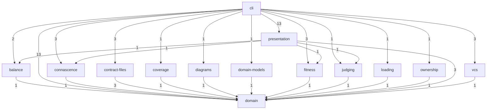

# Architecture

<!-- Rendered by anarch-lint render from the model d160a73cb7a1. Edit the model, not this file. -->

## Subsystems

| Subsystem      | Packages                                                                                                                                                                                                | Interface                                                                                                                                                                     | Owner |
| -------------- | ------------------------------------------------------------------------------------------------------------------------------------------------------------------------------------------------------- | ----------------------------------------------------------------------------------------------------------------------------------------------------------------------------- | ----- |
| cli            | `github.com/StevenACoffman/anarch-lint`, `github.com/StevenACoffman/anarch-lint/cmd/...`, `github.com/StevenACoffman/anarch-lint/internal/pipeline`, `github.com/StevenACoffman/anarch-lint/anarchtest` | `github.com/StevenACoffman/anarch-lint/cmd/root`                                                                                                                              |       |
| presentation   | `github.com/StevenACoffman/anarch-lint/internal/text`, `github.com/StevenACoffman/anarch-lint/internal/schema`, `github.com/StevenACoffman/anarch-lint/internal/sarif`                                  | `github.com/StevenACoffman/anarch-lint/internal/text`, `github.com/StevenACoffman/anarch-lint/internal/schema`, `github.com/StevenACoffman/anarch-lint/internal/sarif`        |       |
| loading        | `github.com/StevenACoffman/anarch-lint/internal/gopackages`                                                                                                                                             | `github.com/StevenACoffman/anarch-lint/internal/gopackages`                                                                                                                   |       |
| vcs            | `github.com/StevenACoffman/anarch-lint/internal/git`                                                                                                                                                    | `github.com/StevenACoffman/anarch-lint/internal/git`                                                                                                                          |       |
| diagrams       | `github.com/StevenACoffman/anarch-lint/internal/plantuml`                                                                                                                                               | `github.com/StevenACoffman/anarch-lint/internal/plantuml`                                                                                                                     |       |
| contract-files | `github.com/StevenACoffman/anarch-lint/internal/openapi`, `github.com/StevenACoffman/anarch-lint/internal/graphql`, `github.com/StevenACoffman/anarch-lint/internal/protobuf`                           | `github.com/StevenACoffman/anarch-lint/internal/openapi`, `github.com/StevenACoffman/anarch-lint/internal/graphql`, `github.com/StevenACoffman/anarch-lint/internal/protobuf` |       |
| domain-models  | `github.com/StevenACoffman/anarch-lint/internal/modelith`                                                                                                                                               | `github.com/StevenACoffman/anarch-lint/internal/modelith`                                                                                                                     |       |
| ownership      | `github.com/StevenACoffman/anarch-lint/internal/codeowners`                                                                                                                                             | `github.com/StevenACoffman/anarch-lint/internal/codeowners`                                                                                                                   |       |
| coverage       | `github.com/StevenACoffman/anarch-lint/internal/coverage`                                                                                                                                               | `github.com/StevenACoffman/anarch-lint/internal/coverage`                                                                                                                     |       |
| fitness        | `github.com/StevenACoffman/anarch-lint/internal/fitness`                                                                                                                                                | `github.com/StevenACoffman/anarch-lint/internal/fitness`                                                                                                                      |       |
| balance        | `github.com/StevenACoffman/anarch-lint/internal/balance`                                                                                                                                                | `github.com/StevenACoffman/anarch-lint/internal/balance`                                                                                                                      |       |
| connascence    | `github.com/StevenACoffman/anarch-lint/internal/connascence`                                                                                                                                            | `github.com/StevenACoffman/anarch-lint/internal/connascence`                                                                                                                  |       |
| judging        | `github.com/StevenACoffman/anarch-lint/internal/judging`                                                                                                                                                | `github.com/StevenACoffman/anarch-lint/internal/judging`                                                                                                                      |       |
| domain         | `github.com/StevenACoffman/anarch-lint/internal/arch`                                                                                                                                                   | `github.com/StevenACoffman/anarch-lint/internal/arch`                                                                                                                         |       |

## Layers

From the top, which may import every layer below it:

1. **command**: `github.com/StevenACoffman/anarch-lint`, `github.com/StevenACoffman/anarch-lint/cmd/...`, `github.com/StevenACoffman/anarch-lint/internal/pipeline`, `github.com/StevenACoffman/anarch-lint/anarchtest`
2. **adapter**: `github.com/StevenACoffman/anarch-lint/internal/text`, `github.com/StevenACoffman/anarch-lint/internal/schema`, `github.com/StevenACoffman/anarch-lint/internal/sarif`, `github.com/StevenACoffman/anarch-lint/internal/gopackages`, `github.com/StevenACoffman/anarch-lint/internal/git`, `github.com/StevenACoffman/anarch-lint/internal/codeowners`, `github.com/StevenACoffman/anarch-lint/internal/modelith`, `github.com/StevenACoffman/anarch-lint/internal/coverage`, `github.com/StevenACoffman/anarch-lint/internal/plantuml`, `github.com/StevenACoffman/anarch-lint/internal/openapi`, `github.com/StevenACoffman/anarch-lint/internal/graphql`, `github.com/StevenACoffman/anarch-lint/internal/protobuf`
3. **domain**: `github.com/StevenACoffman/anarch-lint/internal/arch`, `github.com/StevenACoffman/anarch-lint/internal/connascence`, `github.com/StevenACoffman/anarch-lint/internal/balance`, `github.com/StevenACoffman/anarch-lint/internal/fitness`, `github.com/StevenACoffman/anarch-lint/internal/judging`

## Subsystem Dependencies

As measured in the code:

## Forbidden Imports

| From                                                                                                                                                                                                                                       | May not import                                                                                                                                                                                                                                                                                                                                                | Reason                                                                                                                                                                                                                  |
| ------------------------------------------------------------------------------------------------------------------------------------------------------------------------------------------------------------------------------------------ | ------------------------------------------------------------------------------------------------------------------------------------------------------------------------------------------------------------------------------------------------------------------------------------------------------------------------------------------------------------- | ----------------------------------------------------------------------------------------------------------------------------------------------------------------------------------------------------------------------- |
| `github.com/StevenACoffman/anarch-lint/internal/arch`                                                                                                                                                                                      | `os`, `os/...`, `time`, `math/rand`                                                                                                                                                                                                                                                                                                                           | the domain is a pure functional core: no I/O, no clock, no global randomness (mmi-plan.md §2); a seeded math/rand/v2 source is deterministic, and its libraries are approved by core-approved-libraries (docs/adr/0012) |
| `github.com/StevenACoffman/anarch-lint/internal/connascence`, `github.com/StevenACoffman/anarch-lint/internal/balance`, `github.com/StevenACoffman/anarch-lint/internal/fitness`, `github.com/StevenACoffman/anarch-lint/internal/judging` | `os`, `os/...`, `time`, `math/rand`                                                                                                                                                                                                                                                                                                                           | a measure is a pure functional core like the domain: no I/O, no clock, no global randomness (mmi-plan.md §2); its libraries are approved by core-approved-libraries (docs/adr/0012)                                     |
| `github.com/StevenACoffman/anarch-lint/internal/gopackages`                                                                                                                                                                                | `github.com/StevenACoffman/anarch-lint/internal/git`, `github.com/StevenACoffman/anarch-lint/internal/text`, `github.com/StevenACoffman/anarch-lint/internal/codeowners`, `github.com/StevenACoffman/anarch-lint/internal/modelith`, `github.com/StevenACoffman/anarch-lint/internal/sarif`, `github.com/StevenACoffman/anarch-lint/internal/coverage`        | adapters do not import each other; only cmd wires them (summary_rules §1)                                                                                                                                               |
| `github.com/StevenACoffman/anarch-lint/internal/git`                                                                                                                                                                                       | `github.com/StevenACoffman/anarch-lint/internal/gopackages`, `github.com/StevenACoffman/anarch-lint/internal/text`, `github.com/StevenACoffman/anarch-lint/internal/codeowners`, `github.com/StevenACoffman/anarch-lint/internal/modelith`, `github.com/StevenACoffman/anarch-lint/internal/sarif`, `github.com/StevenACoffman/anarch-lint/internal/coverage` | adapters do not import each other; only cmd wires them (summary_rules §1)                                                                                                                                               |
| `github.com/StevenACoffman/anarch-lint/internal/text`                                                                                                                                                                                      | `github.com/StevenACoffman/anarch-lint/internal/gopackages`, `github.com/StevenACoffman/anarch-lint/internal/git`, `github.com/StevenACoffman/anarch-lint/internal/codeowners`, `github.com/StevenACoffman/anarch-lint/internal/modelith`, `github.com/StevenACoffman/anarch-lint/internal/sarif`, `github.com/StevenACoffman/anarch-lint/internal/coverage`  | adapters do not import each other; only cmd wires them (summary_rules §1)                                                                                                                                               |

## Isolations

| From                                                         | May import only                                       | Reason                                                                                                                      |
| ------------------------------------------------------------ | ----------------------------------------------------- | --------------------------------------------------------------------------------------------------------------------------- |
| `github.com/StevenACoffman/anarch-lint/internal/connascence` | `github.com/StevenACoffman/anarch-lint/internal/arch` | a measure reads arch's facts and knows no adapter and no other measure; only cmd wires them (summary_rules §1, §5)          |
| `github.com/StevenACoffman/anarch-lint/internal/balance`     | `github.com/StevenACoffman/anarch-lint/internal/arch` | a measure reads arch's facts and knows no adapter and no other measure; only cmd wires them (summary_rules §1, §5)          |
| `github.com/StevenACoffman/anarch-lint/internal/fitness`     | `github.com/StevenACoffman/anarch-lint/internal/arch` | a measure reads arch's facts and knows no adapter and no other measure; only cmd wires them (summary_rules §1, §5)          |
| `github.com/StevenACoffman/anarch-lint/internal/judging`     | `github.com/StevenACoffman/anarch-lint/internal/arch` | the judging layer reads arch's slots and verdicts and knows no adapter and no measure; only cmd wires it (mmi-plan.md §9.4) |
| `github.com/StevenACoffman/anarch-lint/internal/modelith`    | `github.com/StevenACoffman/anarch-lint/internal/arch` | adapters do not import each other; only cmd wires them (summary_rules §1)                                                   |
| `github.com/StevenACoffman/anarch-lint/internal/plantuml`    | `github.com/StevenACoffman/anarch-lint/internal/arch` | adapters do not import each other; only cmd wires them (summary_rules §1)                                                   |
| `github.com/StevenACoffman/anarch-lint/internal/openapi`     | `github.com/StevenACoffman/anarch-lint/internal/arch` | adapters do not import each other; only cmd wires them (summary_rules §1)                                                   |
| `github.com/StevenACoffman/anarch-lint/internal/graphql`     | `github.com/StevenACoffman/anarch-lint/internal/arch` | adapters do not import each other; only cmd wires them (summary_rules §1)                                                   |
| `github.com/StevenACoffman/anarch-lint/internal/protobuf`    | `github.com/StevenACoffman/anarch-lint/internal/arch` | adapters do not import each other; only cmd wires them (summary_rules §1)                                                   |
| `github.com/StevenACoffman/anarch-lint/internal/codeowners`  | `github.com/StevenACoffman/anarch-lint/internal/arch` | adapters do not import each other; only cmd wires them (summary_rules §1)                                                   |
| `github.com/StevenACoffman/anarch-lint/internal/coverage`    | `github.com/StevenACoffman/anarch-lint/internal/arch` | adapters do not import each other; only cmd wires them (summary_rules §1)                                                   |
| `github.com/StevenACoffman/anarch-lint/internal/sarif`       | `github.com/StevenACoffman/anarch-lint/internal/arch` | adapters do not import each other; only cmd wires them (summary_rules §1)                                                   |

## Fitness Rules

| Rule                                | Kind          | Gate | Reason                                                                                                                                                                                         |
| ----------------------------------- | ------------- | ---- | ---------------------------------------------------------------------------------------------------------------------------------------------------------------------------------------------- |
| pure-domain                         | layerAccess   | fail | the domain and the measures depend on nothing but themselves (summary_rules §5)                                                                                                                |
| adapters-to-domain                  | layerAccess   | fail | an adapter translates for the domain and knows no command (summary_rules §1)                                                                                                                   |
| x-tools-only-in-loader              | dependents    | fail | go/packages is the loader's dependency, and cover the coverage reader's (summary_rules §1)                                                                                                     |
| core-approved-libraries             | libraries     | fail | the core imports only pure, deterministic, well-tested libraries, each approved here (docs/adr/0012)                                                                                           |
| no-clock-or-os-in-core              | calls         | fail | the functional core reads no clock, does no I/O and draws nothing from the global random source; a source seeded with constants, as Louvain's, is deterministic                                |
| tests-wait-and-configure-explicitly | calls         | fail | a test that sleeps is slow and flaky, and one that reads or sets the environment shares state with every other test: wait on a signal, and pass configuration in (go-advice summary_rules §10) |
| no-unused-api                       | unusedExports | fail | an identifier exported for no other package widens the API and the visibility metrics for nothing; unexport it (IMPROVEMENTS.md §9.2)                                                          |
| core-speaks-its-model               | domains       | fail | the functional core keeps the vocabulary of its domain model (docs/adr/0005)                                                                                                                   |
| core-stays-out-of-the-shell         | cases         | fail | the functional core never reaches into the shell (summary_rules §5)                                                                                                                            |
| adapters-stay-apart                 | cases         | fail | adapters do not import each other; only cmd wires them (summary_rules §1)                                                                                                                      |
| measures-stay-apart                 | cases         | fail | each measure reads only the core's vocabulary                                                                                                                                                  |
| commands-use-the-core               | cases         | fail | the shell may use the core, or nothing works                                                                                                                                                   |
| commands-dispatch-to-the-pipeline   | expects       | fail | a command parses flags and dispatches; the pipeline owns the work (go-advice summary_rules principle 8)                                                                                        |

## Finding Rules

| Rule                        | Gate              | Reason                                                                                                                                 |
| --------------------------- | ----------------- | -------------------------------------------------------------------------------------------------------------------------------------- |
| `interface-bypass`          | as the rule gives | a subsystem is used only through the packages it exposes, so its insides can change freely                                             |
| `layer-order-violation`     | as the rule gives | a command wires adapters to the domain, an adapter translates for the domain, and the domain depends on neither (summary_rules §1, §5) |
| `subsystem-order-violation` | as the rule gives | subsystems depend downward only, so each can be understood and tested with what lies below it                                          |

## Quality Attributes

| Attribute       | Rules                                                                                                                                                                                                                                                                                                                                                                                                                                                                                                                                                                                                                                                                                                                                                                                                                                                                                               |
| --------------- | --------------------------------------------------------------------------------------------------------------------------------------------------------------------------------------------------------------------------------------------------------------------------------------------------------------------------------------------------------------------------------------------------------------------------------------------------------------------------------------------------------------------------------------------------------------------------------------------------------------------------------------------------------------------------------------------------------------------------------------------------------------------------------------------------------------------------------------------------------------------------------------------------- |
| security        | `fitness.libraries core-approved-libraries`                                                                                                                                                                                                                                                                                                                                                                                                                                                                                                                                                                                                                                                                                                                                                                                                                                                         |
| maintainability | `layers`, `subsystemOrder`, `interfaces`, `forbiddenImports[0]`, `forbiddenImports[1]`, `forbiddenImports[2]`, `forbiddenImports[3]`, `forbiddenImports[4]`, `isolations[0]`, `isolations[1]`, `isolations[2]`, `isolations[3]`, `isolations[4]`, `isolations[5]`, `isolations[6]`, `isolations[7]`, `isolations[8]`, `isolations[9]`, `isolations[10]`, `isolations[11]`, `fitness.layerAccess pure-domain`, `fitness.layerAccess adapters-to-domain`, `fitness.dependents x-tools-only-in-loader`, `fitness.calls no-clock-or-os-in-core`, `fitness.calls tests-wait-and-configure-explicitly`, `fitness.unusedExports no-unused-api`, `fitness.domains core-speaks-its-model`, `fitness.cases core-stays-out-of-the-shell`, `fitness.cases adapters-stay-apart`, `fitness.cases measures-stay-apart`, `fitness.cases commands-use-the-core`, `fitness.expects commands-dispatch-to-the-pipeline` |

## Domain Models

### `anarch-lint.modelith.yaml`

Describes subsystem domain.

Entities: Baseline, DomainModel, Finding, Input, JudgementSlot, Model, Program, Report, Verdict, VerificationEvent.

Enums: Basis (fact, candidate), EventRole (judge, human, adversary), RuleGate (fail, warn, off), Severity (error, warning).
