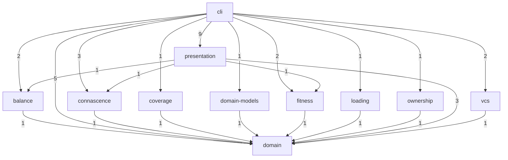

# Architecture

<!-- Rendered by anarch-lint render from the model 79a237bcdb41. Edit the model, not this file. -->

## Subsystems

| Subsystem     | Packages                                                                                                                                                               | Interface                                                                                                                                                              | Owner |
| ------------- | ---------------------------------------------------------------------------------------------------------------------------------------------------------------------- | ---------------------------------------------------------------------------------------------------------------------------------------------------------------------- | ----- |
| cli           | `github.com/StevenACoffman/anarch-lint`, `github.com/StevenACoffman/anarch-lint/cmd/...`                                                                               | `github.com/StevenACoffman/anarch-lint/cmd/root`                                                                                                                       |       |
| presentation  | `github.com/StevenACoffman/anarch-lint/internal/text`, `github.com/StevenACoffman/anarch-lint/internal/schema`, `github.com/StevenACoffman/anarch-lint/internal/sarif` | `github.com/StevenACoffman/anarch-lint/internal/text`, `github.com/StevenACoffman/anarch-lint/internal/schema`, `github.com/StevenACoffman/anarch-lint/internal/sarif` |       |
| loading       | `github.com/StevenACoffman/anarch-lint/internal/gopackages`                                                                                                            | `github.com/StevenACoffman/anarch-lint/internal/gopackages`                                                                                                            |       |
| vcs           | `github.com/StevenACoffman/anarch-lint/internal/git`                                                                                                                   | `github.com/StevenACoffman/anarch-lint/internal/git`                                                                                                                   |       |
| domain-models | `github.com/StevenACoffman/anarch-lint/internal/modelith`                                                                                                              | `github.com/StevenACoffman/anarch-lint/internal/modelith`                                                                                                              |       |
| ownership     | `github.com/StevenACoffman/anarch-lint/internal/codeowners`                                                                                                            | `github.com/StevenACoffman/anarch-lint/internal/codeowners`                                                                                                            |       |
| coverage      | `github.com/StevenACoffman/anarch-lint/internal/coverage`                                                                                                              | `github.com/StevenACoffman/anarch-lint/internal/coverage`                                                                                                              |       |
| fitness       | `github.com/StevenACoffman/anarch-lint/internal/fitness`                                                                                                               | `github.com/StevenACoffman/anarch-lint/internal/fitness`                                                                                                               |       |
| balance       | `github.com/StevenACoffman/anarch-lint/internal/balance`                                                                                                               | `github.com/StevenACoffman/anarch-lint/internal/balance`                                                                                                               |       |
| connascence   | `github.com/StevenACoffman/anarch-lint/internal/connascence`                                                                                                           | `github.com/StevenACoffman/anarch-lint/internal/connascence`                                                                                                           |       |
| domain        | `github.com/StevenACoffman/anarch-lint/internal/arch`                                                                                                                  | `github.com/StevenACoffman/anarch-lint/internal/arch`                                                                                                                  |       |

## Layers

From the top, which may import every layer below it:

1. **command**: `github.com/StevenACoffman/anarch-lint`, `github.com/StevenACoffman/anarch-lint/cmd/...`
2. **adapter**: `github.com/StevenACoffman/anarch-lint/internal/text`, `github.com/StevenACoffman/anarch-lint/internal/schema`, `github.com/StevenACoffman/anarch-lint/internal/sarif`, `github.com/StevenACoffman/anarch-lint/internal/gopackages`, `github.com/StevenACoffman/anarch-lint/internal/git`, `github.com/StevenACoffman/anarch-lint/internal/codeowners`, `github.com/StevenACoffman/anarch-lint/internal/modelith`, `github.com/StevenACoffman/anarch-lint/internal/coverage`
3. **domain**: `github.com/StevenACoffman/anarch-lint/internal/arch`, `github.com/StevenACoffman/anarch-lint/internal/connascence`, `github.com/StevenACoffman/anarch-lint/internal/balance`, `github.com/StevenACoffman/anarch-lint/internal/fitness`

## Subsystem Dependencies

As measured in the code:

## Forbidden Imports

| From                                                                                                                                                                             | May not import                                                                                                                                                                                                                                                                                                                                                | Reason                                                                                                                                                                                                                  |
| -------------------------------------------------------------------------------------------------------------------------------------------------------------------------------- | ------------------------------------------------------------------------------------------------------------------------------------------------------------------------------------------------------------------------------------------------------------------------------------------------------------------------------------------------------------- | ----------------------------------------------------------------------------------------------------------------------------------------------------------------------------------------------------------------------- |
| `github.com/StevenACoffman/anarch-lint/internal/arch`                                                                                                                            | `os`, `os/...`, `time`, `math/rand`                                                                                                                                                                                                                                                                                                                           | the domain is a pure functional core: no I/O, no clock, no global randomness (mmi-plan.md §2); a seeded math/rand/v2 source is deterministic, and its libraries are approved by core-approved-libraries (docs/adr/0012) |
| `github.com/StevenACoffman/anarch-lint/internal/connascence`, `github.com/StevenACoffman/anarch-lint/internal/balance`, `github.com/StevenACoffman/anarch-lint/internal/fitness` | `os`, `os/...`, `time`, `math/rand`                                                                                                                                                                                                                                                                                                                           | a measure is a pure functional core like the domain: no I/O, no clock, no global randomness (mmi-plan.md §2); its libraries are approved by core-approved-libraries (docs/adr/0012)                                     |
| `github.com/StevenACoffman/anarch-lint/internal/gopackages`                                                                                                                      | `github.com/StevenACoffman/anarch-lint/internal/git`, `github.com/StevenACoffman/anarch-lint/internal/text`, `github.com/StevenACoffman/anarch-lint/internal/codeowners`, `github.com/StevenACoffman/anarch-lint/internal/modelith`, `github.com/StevenACoffman/anarch-lint/internal/sarif`, `github.com/StevenACoffman/anarch-lint/internal/coverage`        | adapters do not import each other; only cmd wires them (summary_rules §1)                                                                                                                                               |
| `github.com/StevenACoffman/anarch-lint/internal/git`                                                                                                                             | `github.com/StevenACoffman/anarch-lint/internal/gopackages`, `github.com/StevenACoffman/anarch-lint/internal/text`, `github.com/StevenACoffman/anarch-lint/internal/codeowners`, `github.com/StevenACoffman/anarch-lint/internal/modelith`, `github.com/StevenACoffman/anarch-lint/internal/sarif`, `github.com/StevenACoffman/anarch-lint/internal/coverage` | adapters do not import each other; only cmd wires them (summary_rules §1)                                                                                                                                               |
| `github.com/StevenACoffman/anarch-lint/internal/text`                                                                                                                            | `github.com/StevenACoffman/anarch-lint/internal/gopackages`, `github.com/StevenACoffman/anarch-lint/internal/git`, `github.com/StevenACoffman/anarch-lint/internal/codeowners`, `github.com/StevenACoffman/anarch-lint/internal/modelith`, `github.com/StevenACoffman/anarch-lint/internal/sarif`, `github.com/StevenACoffman/anarch-lint/internal/coverage`  | adapters do not import each other; only cmd wires them (summary_rules §1)                                                                                                                                               |

## Isolations

| From                                                         | May import only                                       | Reason                                                                                                             |
| ------------------------------------------------------------ | ----------------------------------------------------- | ------------------------------------------------------------------------------------------------------------------ |
| `github.com/StevenACoffman/anarch-lint/internal/connascence` | `github.com/StevenACoffman/anarch-lint/internal/arch` | a measure reads arch's facts and knows no adapter and no other measure; only cmd wires them (summary_rules §1, §5) |
| `github.com/StevenACoffman/anarch-lint/internal/balance`     | `github.com/StevenACoffman/anarch-lint/internal/arch` | a measure reads arch's facts and knows no adapter and no other measure; only cmd wires them (summary_rules §1, §5) |
| `github.com/StevenACoffman/anarch-lint/internal/fitness`     | `github.com/StevenACoffman/anarch-lint/internal/arch` | a measure reads arch's facts and knows no adapter and no other measure; only cmd wires them (summary_rules §1, §5) |
| `github.com/StevenACoffman/anarch-lint/internal/modelith`    | `github.com/StevenACoffman/anarch-lint/internal/arch` | adapters do not import each other; only cmd wires them (summary_rules §1)                                          |
| `github.com/StevenACoffman/anarch-lint/internal/codeowners`  | `github.com/StevenACoffman/anarch-lint/internal/arch` | adapters do not import each other; only cmd wires them (summary_rules §1)                                          |
| `github.com/StevenACoffman/anarch-lint/internal/coverage`    | `github.com/StevenACoffman/anarch-lint/internal/arch` | adapters do not import each other; only cmd wires them (summary_rules §1)                                          |
| `github.com/StevenACoffman/anarch-lint/internal/sarif`       | `github.com/StevenACoffman/anarch-lint/internal/arch` | adapters do not import each other; only cmd wires them (summary_rules §1)                                          |

## Fitness Rules

| Rule                    | Kind        | Gate | Reason                                                                                                                                                          |
| ----------------------- | ----------- | ---- | --------------------------------------------------------------------------------------------------------------------------------------------------------------- |
| pure-domain             | layerAccess | fail | the domain and the measures depend on nothing but themselves (summary_rules §5)                                                                                 |
| adapters-to-domain      | layerAccess | fail | an adapter translates for the domain and knows no command (summary_rules §1)                                                                                    |
| x-tools-only-in-loader  | dependents  | fail | go/packages is the loader's dependency, and cover the coverage reader's (summary_rules §1)                                                                      |
| core-approved-libraries | libraries   | fail | the core imports only pure, deterministic, well-tested libraries, each approved here (docs/adr/0012)                                                            |
| no-clock-or-os-in-core  | calls       | fail | the functional core reads no clock, does no I/O and draws nothing from the global random source; a source seeded with constants, as Louvain's, is deterministic |
| core-speaks-its-model   | domains     | fail | the functional core keeps the vocabulary of its domain model (docs/adr/0005)                                                                                    |

## Domain Models

### `anarch-lint.modelith.yaml`

Describes subsystem domain.

Entities: Baseline, DomainModel, Finding, Input, JudgementSlot, Model, Program, Report, Verdict, VerificationEvent.

Enums: Basis (candidate, fact), EventRole (human, judge), RuleGate (fail, off, warn), Severity (error, warning).
