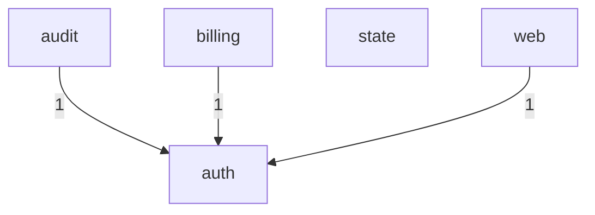

# Architecture

<!-- Rendered by anarch-lint render from the model 431b952e8ede. Edit the model, not this file. -->

## Subsystems

| Subsystem | Packages                                              | Interface             | Owner |
| --------- | ----------------------------------------------------- | --------------------- | ----- |
| auth      | `example.com/cx/auth`                                 | `example.com/cx/auth` |       |
| billing   | `example.com/cx/billing`, `example.com/cx/cmd/client` |                       |       |
| web       | `example.com/cx/web`, `example.com/cx/cmd/server`     |                       |       |
| state     | `example.com/cx/state`                                |                       |       |
| audit     | `example.com/cx/audit`                                |                       |       |

## Layers

From the top, which may import every layer below it:

1. **app**: `example.com/cx/cmd/...`
2. **feature**: `example.com/cx/billing`, `example.com/cx/web`, `example.com/cx/audit`
3. **core**: `example.com/cx/auth`, `example.com/cx/state`

## Subsystem Dependencies

As measured in the code:

## Forbidden Imports

| From                 | May not import | Reason                 |
| -------------------- | -------------- | ---------------------- |
| `example.com/cx/...` | `net/http`     | no HTTP in the fixture |

## Fitness Rules

| Rule                 | Kind           | Gate | Reason                                     |
| -------------------- | -------------- | ---- | ------------------------------------------ |
| onion[0]             | onion          | fail |                                            |
| core-from-features   | layerAccess    | fail | binaries reach the core through a feature  |
| areas                | slices         | fail |                                            |
| auth-for-billing     | dependents     | warn | only billing should know roles             |
| nothing-yet          | dependents     | fail |                                            |
| maybe-later          | dependents     | fail |                                            |
| no-clock-in-features | calls          | fail | inject a clock                             |
| patterns-in-billing  | calls          | fail |                                            |
| web-ports            | interfacesOnly | fail |                                            |
| cx-model             | domains        | fail | the code speaks the fixture's domain model |

## Domain Models

### `cx.modelith.yaml`

Describes the whole program.

Entities: Credentials, Invoice, Ledger, Role, Session.

Enums: Currency (usd), Level (High, Low, Mid, Top).
